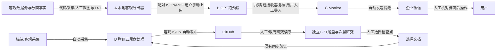

# 系统总览与边界

updated_at: 2026-10-28T19:02:46+08:00
source_commit: 0e345374a190d9bd3fb57419381284f87fc8ecc8 (本机工作副本，逐文件SHA为准)
owner: 主Codex（工程）/用户与主GPT（策略与状态）
evidence_level: VERIFIED_CODE + PRIOR_REPORTED；无本轮 VERIFIED_RUNTIME
next_recheck: 下一次正式验收；云端修复另待下一真实交易日

本机可见的是客观信息导出器及提醒程序，没有证据表明存在执行GPT投资分析的所谓“主程序”。V10指用户的GPT预设对话与治理流程，不能命名为本地分析引擎。A/B/C属于A股跑预设主路径；D是隔离的尾盘隔夜项目。

|来源→去向|产物/传递|实现证据与边界|
|---|---|---|
|数据源→A|行情、事件、日线/分钟缓存，自动|本地代码可见；本轮不调用供应商，具体可用性未实测|
|券商→A|截图/TXT，人工提供|源码存在解析；不公开原件，不代表券商当前时钟或成交全集|
|A→B|配对JSON/PDF，人工上传|用户提供的工作流；私人GPT实际接收不可访问|
|B→C|提醒拟稿，人工校验导入|接收器代码可核；没有自动GPT接口证据|
|C→企业微信|仅提醒，自动|既有发送链；历史API接受不等于用户实际收件|
|用户→券商|人工操作|账户执行边界，不存在本任务自动下单授权|
|采集→云→GitHub|客观JSON，既有自动链|本地镜像代码+公开commit；服务器当前运行未核|
|GitHub→GPT→选择文件|读取研究、人工选择|代码存在选择验证；本次不写选择，不把机器提案视为确认|

账户、分析、通知、部署权限相互独立。三份GPT状态只在B中治理；尾盘A/B/C实验及R2研究不并入账户或共享成交样本。不存在本任务验证过的“导出器自动调用GPT/直接下单”接口。

[返回总入口](README.md) · [证据索引](architecture_evidence_index.json)
